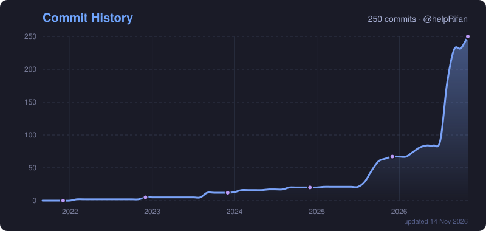

<!-- Header banner -->

  

<!-- Badges -->

  
  
  
  
  
  

 

<!-- Typing intro -->

  

### 🧑‍💻 About me

- 🔭 Working on **[Kaivarigal](https://github.com/helpRifan/kaivarigal)**, a robot that writes on paper in my own handwriting (PyTorch + OpenCV + a pen plotter)
- 🛸 Building **FLYORA**, an autonomous drone that inspects solar farms with edge AI
- 🤖 Building the website for the **Robotics Club at VIT Chennai**
- 🌱 Into ML, computer vision, Chrome extensions, games and tinkering with Raspberry Pi / Arduino
- 🌐 More at **[rifan.me](https://rifan.me)**

### 🛠️ Projects

| Project | What it is | Stack |
|---|---|---|
| ✍️ [kaivarigal](https://github.com/helpRifan/kaivarigal) | Pen-plotter robot that writes text in my own handwriting | Python · PyTorch · OpenCV · FastAPI |
| 🛸 **FLYORA** | Autonomous drone for solar-panel inspection: spots faults with a thermal camera, rescans them on its own and tracks how they get worse over time (TransVIT 2026) | ArduPilot · Raspberry Pi 5 · FLIR Lepton · YOLOv8 |
| 📱 [lifeos](https://github.com/helpRifan/lifeos) | Life OS, my personal tracker app: tasks, VTOP attendance, gym, focus sessions, calendar and push reminders, installable on iPhone | React · Vite · Capacitor · Cloudflare Workers |
| 🤖 [rc_web](https://github.com/helpRifan/rc_web) | Web platform for the Robotics Club, VIT Chennai: members, events, galleries | React · TypeScript · Tailwind · Express |
| 🧩 [catche](https://github.com/helpRifan/catche) | Chrome extension that solves VTOP login captchas, fully offline | JavaScript |
| 📍 [attendance-app](https://github.com/helpRifan/attendance-app) | Role-based attendance tracker with GPS geofencing and live admin dashboards | TypeScript |
| 💉 [Insulin-Dose-Tracker](https://github.com/helpRifan/Insulin-Dose-Tracker) | Insulin logger hardware + web app with AI-driven advice | Full-stack · hardware |
| 💰 [CryptoTaxMate](https://github.com/helpRifan/CryptoTaxMate) | Crypto tax calculator and reports for the USA, India and UK | HTML · JS |
| 🎮 [topdowngame](https://github.com/helpRifan/topdowngame) | 2D top-down game | Phaser.js · TypeScript |
| 🌐 [rifan.me](https://github.com/helpRifan/helpRifan.github.io) | My portfolio site | TypeScript |

### 📊 GitHub stats

  
  

### 📈 Commit history

  

  

<!-- Footer wave -->

  

